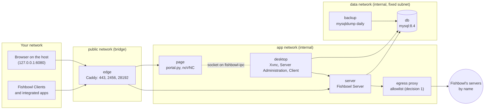

# Fishbowl Server: Enterprise Container Blueprint

First written 18 November 2026 by Danny Page; revised 19 November 2026 (Fedora 45,
Phase 1b in the repository, gates as a script).

## Summary

Fishbowl Server moves from one all-in-one container to a set of single-purpose
containers on private networks, and nothing but the ports you've approved faces the
LAN. The work lands in five phases. Phase 1 (hardening) has shipped. **Phase 1b**,
in this revision of the repository, moves the image to **Fedora Linux 45** and
brings the parts of all four workstreams that don't depend on the split into
today's single container: a hang watchdog, scheduled backups with checksums, both
of Fishbowl's own logs on the container's output, the heap from `.env`, and volumes
Compose can't delete. Phases 2 to 5 follow in order, each behind its own tests.

**The four workstreams**

- **Image:** a multi-stage build with no build tools left in the final layer, on a
  base that gets security fixes, with a Java 21 runtime. Every long-running process
  runs as a non-root user. Today: Fedora 45; target: an enterprise LTS base (UBI 9).
- **Compose:** MySQL 8.4 gets its own container on a network with no route outside.
  Ports, memory, heap and schedules live in `.env`, and credentials arrive as
  Docker secrets.
- **Persistence and recovery:** external named volumes, a scheduled `mysqldump` job
  with retention, checksums and an offsite copy, and a restore drill that proves
  the backups actually restore.
- **Self-healing:** health checks that lead to a restart. Docker only restarts a
  container that exits, so a hung Fishbowl Server has to be turned into a restart.

**Your four decisions, carried through**

| Decision | What it means here |
|---|---|
| 1. Outbound allowlist | Only the hostnames Fishbowl 26.10's own program files call. Fishbowl's help site publishes no list, so the cutsheet IPs (97.75.181.39, 97.75.181.50, 199.79.55.108) are out. |
| 2. Closed ports | 28292, 28182, 28282, 3305 and 8080 are closed inbound and outbound. Only 2456 and 28192 face the LAN (plus 443 once the HTTPS front door lands), and the Fishbowl page (6080) stays on the host's loopback. |
| 3. Fixed MySQL root password | Stays, as the one documented exception to "no baked credentials." Its guard has to change when MySQL moves to its own container (Workstream 2). |
| 4. Updates can't stall | Every image build runs `update-all.sh --build`, and the weekly maintenance rebuilds with a backup and an automatic rollback, whether or not anyone remembers. |

Done means gates G1 to G7 pass on the production host; `tests/gates.sh` runs them.
Anything that depends on how Fishbowl behaves on the inside is marked **needs
empirical test**, and the last section gives the exact steps for each one.

## Where things stand today

One Fedora 45 container runs everything, hardened (Phase 1) and with the Phase 1b
pieces below. It already gets the hard parts right: your EULA acceptance at first
start, a supervisor that restarts Fishbowl Server in place, and named volumes that
survive a rebuild.

| Area | Today (Phase 1b) | Gap still open |
|---|---|---|
| Base | Fedora 45 (`registry.fedoraproject.org/fedora:45`), Temurin 21 JDK from Adoptium, MySQL 8.4 from Fedora's versioned `mysql8.4` packages | Fedora isn't an LTS base (about 13 months per release, so a move to the next release twice a year), and a full JDK ships where a JRE may do (E8) |
| Processes | `tini`, then a root supervisor that drops MySQL (uid 27), Fishbowl (1000) and the page (1001) with `setpriv` | PID 1 runs as root (CIS 4.1) |
| Filesystem and privileges | Read-only root, tmpfs `/run`, `/tmp`, `/var/tmp`; `--cap-drop ALL` plus six; `no-new-privileges`; `pids_limit` | Six capabilities stay while one container hands out three users |
| MySQL | Same container, 127.0.0.1 only, root limited to localhost | Can't be limited, patched or restarted on its own |
| Network | 2456 and 28192 on `FB_LAN_IP`, 6080 on 127.0.0.1; `fishbowl-netcheck` flags any other listener | Outbound traffic is checked, not enforced |
| Volumes | `fishbowl-mysql`, `fishbowl-app`, `fishbowl-data`, fixed names, **external** in `compose.yaml` | None for Compose; `docker volume rm` still deletes, as it should |
| Health | Status file, `mysqladmin ping`, and an **HTTP answer** on 2456 (`probe.py`) once the watchdog has seen one | The HTTP request is the right one only if E3 passes |
| Restarts | `restart: always`; the supervisor restarts a crashed Fishbowl Server or MySQL in place; the **watchdog** ends one that stops answering and restarts it; after 4 unplanned restarts in 10 minutes it holds | Hang detection proven only by the suite's freeze test (E3, E4) |
| Logs | Supervisor lines on stdout with UTC timestamps; with `FB_LOG_STREAM=1` (Compose default) `fbserver.log` and `mysqld.log` copied in as `[fbserver]` and `[mysqld]`, secrets blanked; rotation 5 x 10 MB | Copied with a follower, not a console appender (E7) |
| Backups | **Daily** `fishbowl-backup --label scheduled` at `FB_BACKUP_TIME`, newest `FB_BACKUP_KEEP` kept, with Fishbowl's settings files and SHA-256 checksums; `--verify`; weekly maintenance backup; pre-upgrade backup | Offsite copy is a host job you still have to schedule |
| Heap | `FB_SERVER_XMX` in `.env` wins over Server Administration when set | E6 confirms on a real start |
| Updates | `update-all.sh --build` in every build; the weekly maintenance rebuilds and rolls back on failure | None (decision 4 met) |

One fact frames everything below. [Fishbowl's own site](https://www.fishbowlinventory.com/integrations/windows)
calls Windows its preferred platform and lists "no support for Linux," so every
Linux base here sits outside Fishbowl Support. Fishbowl-internal behavior has to be
proven by test, not by documentation.

### Fedora 45: what changed for this image

Fedora 45 came out on 3 November 2026. Three of its changes touch the build, and the
Dockerfile handles each one:

1. **`mysql-server` now means MySQL 9.7.** Fedora 45 switched its default MySQL from
   8.4 to 9.7, and Fishbowl rejects 9.x. MySQL 8.4 stays available under versioned
   names, so the image installs `mysql8.4-server` and `mysql8.4` pinned to `8.4.*`
   (8.4.11 at release). `verify-runtime.sh` still stops the build on anything but 8.4.x.
2. **Adoptium's Temurin tree can lag a new Fedora release.** Adoptium publishes one
   RPM tree per Fedora release, and Fedora 45's wasn't there at release.
   `adoptium-repo.py` writes the repository file at build time from the newest tree
   that exists (Fedora 45's, or 44's, or 43's), limited to Temurin 21 and checked
   against Adoptium's signing key. Temurin's packages don't depend on one Fedora
   release. Each weekly rebuild checks again.
3. **RPM signatures are now required** and repository files moved to
   `/usr/share/dnf5/repos.d`. Every package here comes from a signed repository, and
   `update-all.sh` looks for repository files in both places.

Fedora releases get updates for about 13 months, so plan the move to Fedora 46
(due around May 2027) while 45 is still supported. The move is one line,
`ARG FEDORA_IMAGE`, then the full suite (README section 14).

## Target architecture

Seven single-purpose containers on two internal networks replace today's one. Every
connection that's allowed is drawn.



Browsers, Fishbowl Clients and integrated apps only ever reach the edge. The page
talks to the Fishbowl windows through a socket on a shared in-memory volume, so the
one container facing browsers never holds the database password; the desktop's line
to MySQL is for the installer's database step.

## Workstream 1: the images

### Today (Phase 1b): two stages on Fedora 45

```
FROM fedora:45 AS installer     # finds the installer on the release, checks size and SHA-256
FROM fedora:45                  # runtime: mysql8.4, Temurin 21, the window pieces, update-all.sh --build
COPY --from=installer /out/ /opt/fishbowl-installer/
```

The installer stage's Python and download tools never reach the runtime image. The
runtime stage installs, updates (`update-all.sh --build`), checks
(`verify-runtime.sh`) and cleans the package cache in one layer.

### Target (Phase 5): three stages, enterprise base, JRE only

The Fishbowl Server image moves to Eclipse Temurin's `21-jre-ubi9-minimal` (Red Hat
UBI 9) and builds in three stages, so only the runtime layer ships. MySQL comes from
the official `mysql:8.4` image, which is built on Oracle Linux 9 and runs mysqld as
uid 999.

| Image | Base | Why | Catch |
|---|---|---|---|
| server | `eclipse-temurin:21-jre-ubi9-minimal` | RHEL-compatible LTS base, JRE only, small package set | None of the window packages, which the server doesn't need anyway |
| page | UBI 9 minimal with Python 3 | Runs `portal.py` and serves noVNC's static files | noVNC's files get copied in from the desktop build |
| desktop | AlmaLinux 9 with EPEL, Temurin 21 JRE | Carries Xvnc, openbox, websockify and noVNC for the Fishbowl windows | EPEL package availability needs a build check (E15) |
| db, backup | `mysql:8.4` | Official, patched by its maintainers, ships `mysqldump` | Its entrypoint makes root reachable from any host (`%`) unless told otherwise (Workstream 2) |

Temurin also publishes `21-jre-ubi10-minimal` and `21-jre-noble` (Ubuntu 24.04).
UBI 9 keeps the server in the same RHEL 9 family as MySQL's Oracle Linux 9, with the
`dnf`-style tooling `update-all.sh` already uses. If you'd rather stay on Fedora,
the same three stages work on `fedora:45` (or later) with a twice-yearly release
move; the trade is a shorter support window for fresher packages.

**Server build stages**

1. `fetch`: today's installer stage, unchanged. It downloads the Fishbowl installer
   from your GitHub release and pins it by asset ID and SHA-256. It also fetches a
   checksum-verified static `tini` release, so PID 1 doesn't depend on a
   distribution package.
2. `runtime-base`: the JRE image pinned by digest, plus fonts for reports.
   `update-all.sh --build` applies every pending update in the same layer and fails
   the build if a repository can't be reached (decision 4). Caches are removed and
   setuid and setgid bits stripped.
3. `server`: the verified installer, the server scripts, user `fishbowl` (uid 1000),
   `USER 1000:1000`, the health check and the entrypoint. No compilers, package
   caches or GUI libraries.

```
# syntax=docker/dockerfile:1
ARG JRE_IMAGE=eclipse-temurin:21-jre-ubi9-minimal@sha256:<pinned digest>

FROM registry.access.redhat.com/ubi9/ubi-minimal@sha256:<pinned digest> AS fetch
# Today's installer stage: download, check SHA-256, extract the EULA.
# Also fetch a static tini and check its SHA-256. Everything lands in /out.

FROM ${JRE_IMAGE} AS runtime-base
COPY rootfs/usr/local/bin/update-all.sh /usr/local/bin/update-all.sh
ARG PACKAGES_REFRESH=unset          # the weekly build passes a new value: never from cache
RUN microdnf -y install --setopt=install_weak_deps=0 fontconfig dejavu-sans-fonts shadow-utils \
 && /usr/local/bin/update-all.sh --build \
 && useradd --uid 1000 --user-group --no-create-home \
      --home-dir /var/lib/fishbowl/home/fishbowl --shell /sbin/nologin fishbowl \
 && microdnf -y remove shadow-utils && microdnf clean all \
 && find / -xdev -perm /6000 -type f -exec chmod a-s {} +

FROM runtime-base AS server
COPY --from=fetch /out/tini /usr/bin/tini
COPY --from=fetch /out/installer/ /opt/fishbowl-installer/
COPY rootfs-server/ /
USER 1000:1000
EXPOSE 2456 28192
HEALTHCHECK --interval=10s --timeout=5s --start-period=<from E4> --start-interval=5s --retries=3 \
  CMD ["/usr/local/bin/fishbowl-healthcheck"]
ENTRYPOINT ["/usr/bin/tini", "--", "/usr/local/bin/fishbowl-entrypoint"]
```

**Supply chain**

- Every `FROM` pinned by digest in Phase 5, and the weekly CI job bumps the digests
  and rebuilds (decision 4). Today's `FROM fedora:45` is a tag, refreshed weekly.
- CI builds publish an SBOM and provenance: `docker buildx build --sbom=true --provenance=mode=max` (Phase 5).
- CI scans every build with Trivy for fixable High and Critical CVEs. Today the step
  reports without blocking (`continue-on-error`); remove that line to make it a
  release gate once a few weekly runs show what Fedora 45 reports.

## Workstream 2: Compose, .env and secrets

### Today (Phase 1b)

One service, `fishbowl`, with every per-site setting in `.env` (copied from
`.env.example`; never a password):

```
FB_TZ=America/Denver
FB_LAN_IP=0.0.0.0          # name one address to keep the ports off other networks (CIS 5.14)
FB_CLIENT_PORT=2456
FB_API_PORT=28192
FB_PAGE_PORT=6080          # always published on 127.0.0.1
FB_SERVER_XMX=             # Fishbowl Server's heap, e.g. 6g; empty: Server Administration's value
FB_MEM_LIMIT=0             # container memory cap, e.g. 14g; 0: none
FB_BACKUP_TIME=01:17       # daily backup, in FB_TZ; "off" for none
FB_BACKUP_KEEP=7
FB_LOG_STREAM=1
FB_WATCHDOG=1
```

**Heap from `.env`.** When `FB_SERVER_XMX` is set, the entrypoint writes it into
`Fishbowl Server Service.vmoptions`, the file the server launcher reads, before
every start, so it wins over Server Administration's memory field. Left empty,
Server Administration's value stands (E6). Keep `FB_MEM_LIMIT` well above the heap,
because the JVM also uses memory outside it.

### Target (Phase 4): networks, secrets, MySQL on its own

- `public` (a normal bridge): only the edge publishes ports, each bound to `FB_LAN_IP` (CIS 5.14).
- `app` (internal): edge, server, page, desktop and the egress proxy.
- `data` (internal, fixed subnet): db, backup, server and desktop. The page is never on it.

```yaml
name: fishbowl

x-hardened: &hardened
  read_only: true
  cap_drop: [ALL]
  security_opt: ["no-new-privileges:true"]
  pids_limit: 512
  restart: always
  logging:
    driver: json-file
    options: { max-size: "10m", max-file: "5" }

services:
  db:
    <<: *hardened
    image: mysql:8.4@sha256:<pinned digest>
    container_name: fishbowl-db
    user: "999:999"                 # 27:27 to keep today's volume as is (E14)
    command: ["--lower-case-table-names=1"]
    environment:
      MYSQL_ROOT_PASSWORD_FILE: /run/secrets/mysql_root
      MYSQL_ROOT_HOST: ${FB_DATA_ROOT_HOST}   # the data subnet, never %
      TZ: ${FB_TZ}
    secrets: [mysql_root]
    volumes:
      - fishbowl-mysql:/var/lib/mysql
      - fishbowl-dbconf:/etc/mysql/conf.d:ro
    tmpfs: ["/var/run/mysqld", "/tmp"]
    networks: [data]
    mem_limit: ${FB_DB_MEM_LIMIT}
    healthcheck:
      test: ["CMD", "mysqladmin", "ping", "--silent", "--socket=/var/run/mysqld/mysqld.sock"]
      interval: 10s
      timeout: 5s
      retries: 3
      start_period: 60s

  server:
    <<: *hardened
    image: fishbowl-server@sha256:<pinned digest>
    platform: linux/amd64
    container_name: fishbowl-server
    environment:
      FB_DB_HOST: db
      FISHBOWL_SERVER_XMX: ${FB_SERVER_XMX}
      TZ: ${FB_TZ}
    secrets: [mysql_root]
    volumes:
      - fishbowl-app:/opt/Fishbowl
      - fishbowl-data:/var/lib/fishbowl
      - fishbowl-ipc:/run/fishbowl-ipc
      - fishbowl-dbconf:/run/fishbowl-dbconf
    tmpfs: ["/run/fishbowl", "/tmp:exec"]
    networks: [app, data]
    mem_limit: ${FB_SERVER_MEM_LIMIT}
    stop_grace_period: 3m
    depends_on:
      db: { condition: service_healthy }

networks:
  public: {}
  app: { internal: true }
  data:
    internal: true
    ipam:
      config: [{ subnet: "${FB_DATA_SUBNET}" }]

volumes:
  fishbowl-mysql: { external: true }
  fishbowl-app: { external: true }
  fishbowl-data: { external: true }
  fishbowl-backups: { external: true }
  fishbowl-dbconf: { external: true }
  fishbowl-ipc: { external: true }

secrets:
  mysql_root:
    file: ./secrets/mysql-root-password.txt   # decision 3: the one fixed credential
```

Phase 4 adds to `.env`: `FB_SERVER_MEM_LIMIT`, `FB_DB_MEM_LIMIT`,
`FB_DATA_SUBNET=172.31.240.0/24` and `FB_DATA_ROOT_HOST=172.31.240.%`.

**Decision 3 after the split.** Today the fixed root password is contained by where
root can sign in from: localhost inside one container. The password is also public
in the repository, so once MySQL moves out, reachability is its only protection:

- root exists only as `root@localhost` and `root@'172.31.240.%'` (the data subnet),
  never `root@'%'`, which is what the official image creates when `MYSQL_ROOT_HOST`
  isn't set;
- the data network is internal, with no published port, no route out and four members;
- the page, which faces browsers, never joins the data network and never gets the secret;
- the password lives in one file, mounted only where it's needed, and from Phase 4
  no image carries it;
- G7 checks the root accounts on every run.

## Workstream 3: persistence and recovery

All state lives in named volumes created outside Compose, and a scheduled backup
writes a verified dump every day, so a destructive rebuild can't lose data and a
lost host can be rebuilt. Checked on Docker 29.9.3 with Compose 5.7.0: `docker
compose down -v` deleted a Compose-managed volume and left an external one alone.

Create the volumes once (the same in bash, zsh and PowerShell). Existing
installations already have these names, so they carry straight over.

```bash
docker volume create fishbowl-mysql
docker volume create fishbowl-app
docker volume create fishbowl-data
```

Phase 4 adds `fishbowl-backups`, `fishbowl-dbconf` and the in-memory `fishbowl-ipc`
(`docker volume create --driver local --opt type=tmpfs --opt device=tmpfs --opt o=size=64m fishbowl-ipc`).

| Volume | Mounted in | Holds | Protected by |
|---|---|---|---|
| `fishbowl-mysql` | the container (target: db) | MySQL's data directory | Daily dumps, never a file copy of a running MySQL |
| `fishbowl-app` | the container (target: server and desktop; backup read-only) | The Fishbowl install, `eve.properties`, `dbsettings.properties`, Fishbowl's own logs | Settings files in every scheduled backup; a whole-volume archive before upgrades (README section 12) |
| `fishbowl-data` | the container (target: server, desktop) | Setup state, home folders, logs, uploads, and today the backups | An archive before upgrades; offsite copy of `backups/` |

**Server properties and custom reports.** Server properties live in
`/opt/Fishbowl/server/bin/eve.properties`, inside the folder Fishbowl's installer
owns and Fishbowl Server rewrites when it stops. Mounting that one file as its own
volume can break writes that replace a file by renaming it, so it stays on
`fishbowl-app`, and every scheduled backup carries an owner-only copy (it holds your
License Key). Custom reports get their own volume only if E13 shows Fishbowl keeps
them as files; if they're in the database, the dump already has them.

**The scheduled backup (today, in the container)**

- Runs daily at `FB_BACKUP_TIME` in your `FB_TZ`, from a small loop in the
  supervisor rather than cron, and logs one line to the container log.
- Reuses the tested `backup_databases` logic: a free-space check, a
  consistent-snapshot `mysqldump` of every database with routines, events and
  triggers, gzip, the "-- Dump completed" trailer check, mode 0600.
- Adds `scheduled-<UTC>.settings.tar.gz` (`eve.properties` and
  `dbsettings.properties`, owner-only) and `scheduled-<UTC>.sha256`.
- Keeps the newest `FB_BACKUP_KEEP` (default 7) and records the last success in
  `/var/lib/fishbowl/state/last-scheduled-backup`;
  `docker exec fishbowl fishbowl-healthcheck --backup-age 26` exits 1 when it's
  older than 26 hours, for alerting.
- Skipped, with a log line, while a setup or an upgrade runs.
- `docker exec fishbowl fishbowl-backup --verify FILE` re-checks gzip, trailer and
  checksums at any time.

**Target (Phase 4):** the same logic moves to a `backup` container on the data
network only, from the same `mysql:8.4` digest as db, writing to `fishbowl-backups`,
with a deterministic per-company dump (`--order-by-primary --skip-dump-date`) and a
grandfather-father-son retention (14 daily, 8 weekly, 12 monthly).

**Offsite.** The container has no reason to reach your backup storage, so a host job
copies the backups out and offsite, encrypted (restic is one option):

```bash
docker cp fishbowl:/var/lib/fishbowl/backups/. /srv/fishbowl-backups/
restic -r <your repository> backup /srv/fishbowl-backups
```

Open question: where should the offsite copies live?

| Measure | Target | Checked by |
|---|---|---|
| RPO | 24 h with daily dumps; about 15 min if binary logs are shipped too (optional) | G6: age of the newest backup |
| RTO | 60 min to a working Fishbowl on a rebuilt host (proposed; reset after the first drill) | G6: a timed restore |
| Drill | Quarterly, and after every Fishbowl upgrade | G6 |

MySQL 8.x writes binary logs by default unless a setting turns them off;
`SELECT @@log_bin;` shows whether Fishbowl's tuning does.

**Restore paths**

1. Bad data, host fine: stop Fishbowl Server (`fishbowl-server stop`), restore
   (README section 11, the `restore` command), start it.
2. Host lost: a new Linux host, the volumes created, the same image version built or
   pulled, first-time setup run with the same Fishbowl version (your EULA
   acceptance), then the dump restored and the settings files put back from the
   `.settings.tar.gz`.
3. Bad upgrade: the README section 12 rollback from the volume archives.

## Workstream 4: health checks and self-healing

Every check proves real work, and a failed check leads to a restart, because Docker
reports an unhealthy container but never restarts it. On a health change, Docker's
only action is a `health_status` event ([Dockerfile reference](https://docs.docker.com/reference/dockerfile/)).

**What Docker actually does** (its docs, plus tests on Docker 29.9.3):

- A restart policy acts on exits only, and only after a container has stayed up 10
  seconds ([restart policies](https://docs.docker.com/engine/containers/start-containers-automatically/)).
- `on-failure` doesn't restart containers when the daemon restarts, so it can't pass G1. `always` does.
- `docker kill` counts as a manual stop: a `restart: always` test container stayed
  down. Killing its main process from inside, or from the host, restarted it in
  under half a second.
- `depends_on` ordering covers Compose operations, not restarts after a reboot
  ([Compose reference](https://docs.docker.com/reference/compose-file/services/)),
  so a split server waits for db on its own.

**The watchdog (today, in the supervisor)**

1. Once Fishbowl Server is running, checks every `FISHBOWL_WATCHDOG_INTERVAL`
   seconds (5) that MySQL answers `mysqladmin ping` and that Fishbowl Server answers
   an HTTP `HEAD /` on its client port within 5 seconds (`probe.py`; any status
   counts, and a TLS port is tried over TLS).
2. The Fishbowl check arms only after Fishbowl Server has answered once since its
   start, so a port that never speaks HTTP is never mistaken for a hang (the health
   check then stays on a TCP connect).
3. After `FISHBOWL_WATCHDOG_FAILURES` (3) misses in a row: logs `[watchdog]` and
   why, sends SIGTERM to Fishbowl Server's process group, waits 10 s, sends
   SIGKILL, and starts it again. A MySQL that stops answering is killed and
   started again the same way, and Fishbowl Server with it.
4. Keeps the crash-loop guard: after 4 unplanned restarts in 10 minutes it holds in
   `server-failed`, stays up so the page can explain, and stops restarting. That
   guard is the compensating control for not using `on-failure:5` (CIS 5.15).
5. A crash of the supervisor itself ends the container, and `restart: always` brings
   it back in under a second.

Worst case from a hang to the restart beginning: up to 30 s to detect (three 5 s
checks with 5 s timeouts), 10 s to stop, under 1 s to start, so about 41 s.
Fishbowl's own start-up time (E4) comes on top. The cost: under a thread-pool
exhaustion that lasts over 30 seconds, the watchdog restarts Fishbowl Server; raise
`FISHBOWL_WATCHDOG_FAILURES` if a month of data shows that happening without a real hang.

| Check | Today | Interval, timeout, retries | Start period |
|---|---|---|---|
| Docker `HEALTHCHECK` | Status is `running`, MySQL pings, Fishbowl Server answers HTTP (TCP until armed) | 30 s, 10 s, 3 | 10 min |
| Watchdog | MySQL ping and HTTP answer | 5 s, 5 s, 3 | until the first answer |
| Backup age | `fishbowl-healthcheck --backup-age 26` | your monitor's schedule | after the first backup |

In Phase 5 the Docker health check moves to 10 s with `--start-interval=5s` and a
start period of 1.5 times the slowest start in E4.

**Alerts** come from the host, with any monitoring stack fed by
`docker events --filter event=health_status --filter event=die` and the container
log's `[warning]` and `[watchdog]` lines. Alert when the container stays unhealthy
for 2 minutes, `[watchdog]` fires more than 3 times in an hour, or
`fishbowl-healthcheck --backup-age 26` fails.

## Logging

Every event is one line on stdout or stderr starting with a UTC timestamp, so a
collector reads `docker logs` and never reaches into a volume:
`2026-11-18T09:15:02Z [fishbowl] <message>`. The startup banner (the page's link
between two rules of dashes) is the one block of plain lines, on purpose.

| Source | Today (Phase 1b) | Target |
|---|---|---|
| Supervisor and watchdog | stdout, tagged `[fishbowl]` and `[fishbowl] [watchdog]`, warnings on stderr | Same |
| MySQL | `mysqld.log` on `fishbowl-data`, copied to stdout as `[mysqld]` (`FB_LOG_STREAM=1`) | stderr from the official image (E14), UTC timestamps (MySQL's `log_timestamps` default) |
| Fishbowl Server | `/opt/Fishbowl/logs/fbserver.log`, copied to stdout as `[fbserver]` | A console appender that survives upgrades, if E7 finds one |
| Page | Never logs request lines, since they can carry the access code | Same |
| Backup | One line per scheduled run (written, skipped or failed) | One line per step, then size and SHA-256 |

- The copy (`logstream.py`) follows each file through rotation and truncation, tags
  every line (Java stack-trace lines included) so a collector can join them, strips
  control characters, and replaces the MySQL root password, the License Key and
  other password-like values from Fishbowl's settings files, and the page's access
  code with `[redacted]`.
- Compose uses `json-file` with `max-size: 10m` and `max-file: 5`, so disk use is
  bounded and `docker logs` keeps working. `docker run` users add
  `--log-opt max-size=10m --log-opt max-file=5` before turning streaming on.
- Any collector (Fluent Bit, Vector or similar) can read those files on the host.
  If you switch the driver to `syslog`, `gelf` or `fluentd`, Docker keeps a local
  copy for `docker logs`.
- G5 checks that secrets never reach a log.

## Standards mapping

The target meets Twelve-Factor except where Fishbowl is stateful by design, and it
passes the CIS image and runtime checks with two declared deviations. CIS lists
[Docker Benchmark v1.9.0](https://www.cisecurity.org/benchmark/docker) as current,
while [Docker Bench for Security](https://github.com/docker/docker-bench-security)
still implements v1.6.0, so the control numbers below are v1.6.0's and need a
cross-check before a formal audit.

[**Twelve-Factor**](https://12factor.net/)

| Factor | How the design meets it | Status today |
|---|---|---|
| I. Codebase | One repository, one image per service, tagged releases | Met |
| II. Dependencies | MySQL pinned to 8.4 and Java to 21 by package, the installer by asset ID and SHA-256; base images by digest in Phase 5 | Met, except base tags until Phase 5 |
| III. Config | Ports, heap, schedules, time zone and switches in `.env` | Met, except the fixed root password (decision 3) |
| IV. Backing services | MySQL reached by name (`db`) as an attached service | From Phase 4, if E1 passes |
| V. Build, release, run | CI builds; a release is an image plus `compose.yaml`; hosts only run | Met |
| VI. Processes | Fishbowl Server holds state, kept only in named volumes | Partial, by Fishbowl's design |
| VII. Port binding | Services export 2456, 28192 and 6080 | Met |
| VIII. Concurrency | One Fishbowl Server per company database | Not applicable; there's no known supported way to run two |
| IX. Disposability | SIGTERM, a 3-minute clean stop, fast restarts, replaceable containers | Met, with start time from E4 |
| X. Dev/prod parity | The same image and Compose file everywhere; only `.env` differs | Met |
| XI. Logs | Event streams on stdout and stderr | Met with `FB_LOG_STREAM=1` |
| XII. Admin processes | Backups, restores, `fishbowl-server` and upgrades as one-off commands in the same image | Met |

**CIS Docker Benchmark** (v1.6.0 numbering)

| Control | Target state | Status today |
|---|---|---|
| 4.1 A user for the container | `USER` 1000, 1001 or 999 in every image | Deviation until Phase 5: the supervisor starts as root and drops every service to its own user |
| 4.2 Trusted base images | Official Fedora, Temurin and MySQL images, pinned by digest | Pass on source; digest pins in Phase 5 |
| 4.3 No unnecessary packages | Server: JRE, fonts, tini and scripts | Partial: one image carries the window pieces and a JDK |
| 4.4 Scanned and rebuilt for patches | Weekly rebuild plus the Trivy report | Pass (report-only until you make it blocking) |
| 4.6 HEALTHCHECK in images | Every image | Pass |
| 4.8 setuid and setgid removed | Stripped in the final stage | Pass (stripped in the package layer; G3 checks) |
| 4.10 No secrets in Dockerfiles | Today's image carries the fixed root password | Deviation (decision 3) until Phase 4, then a secret file only |
| 5.4 Capabilities restricted | `cap_drop: [ALL]` plus six that start-up needs | Pass |
| 5.9 Only needed ports open | 2456, 28192, and 6080 on loopback; the edge only from Phase 2 | Pass |
| 5.11 Memory limited | `mem_limit` on every service | Optional today (`FB_MEM_LIMIT`) |
| 5.13 Read-only root filesystem | `read_only` plus tmpfs | Pass |
| 5.14 Traffic bound to a host interface | Ports on `FB_LAN_IP`, the page on 127.0.0.1 | Pass once `FB_LAN_IP` names an address |
| 5.15 `on-failure` restart policy set to 5 | `always` instead, so services return after a reboot (G1) | Deviation; the crash-loop guard and restart alerts compensate |
| 5.26 No additional privileges | `no-new-privileges:true` | Pass |
| 5.27 Health checked at runtime | Every service | Pass |
| 5.29 PIDs cgroup limit | `pids_limit` on every service | Pass |
| 5.30 Default bridge unused | User-defined networks only | Pass (Compose's project network) |
| 5.32 Docker socket not mounted | The watchdog lives inside the container; no autoheal container | Pass |

Content trust (4.5) isn't used; package signatures, the installer's SHA-256 and,
from Phase 5, digest pins and build attestations cover much of the same risk.

**SRE targets** (proposed; tune after a month of data)

| Indicator | Target | Measured by |
|---|---|---|
| Healthy samples outside the weekly window | 99.5% per month | Docker health events |
| Fault to restart start | 60 s or less | G4 |
| Age of the newest backup | Under 26 h | `fishbowl-healthcheck --backup-age 26` |
| Restore time | 60 min or less | The G6 drill |
| Unplanned restarts | 3 or fewer per week before someone looks | `[watchdog]` and restart lines |

## Success criteria and validation gates

A phase is done when all seven gates pass on the production host. `tests/gates.sh`
runs them against the Compose deployment (bash on the Linux host, in the folder
with `compose.yaml`); each check prints PASS or FAIL and the script exits non-zero
if any fails.

| Gate | Proves | Passes when | Run |
|---|---|---|---|
| G1 | Zero-touch start after a host reboot | Healthy within 10 min of power-on, with no sign-in and no command | `gates.sh g1-arm`, reboot, `gates.sh g1` |
| G2 | Data survives a destructive rebuild | Company database dump hash and settings-file hashes identical after `down --rmi all --volumes`, a build-cache prune and a no-cache rebuild | `gates.sh g2` |
| G3 | Non-root, minimal surface | MySQL, Java and the page never root; only the supervisor family as root (declared deviation); read-only; `drop=[ALL]` plus the six; `no-new-privileges`; no setuid files; no fixable High or Critical CVE | `gates.sh g3` |
| G4 | Sub-minute failover | Fault to restart start at most 60 s, 5 of 5 trials, for a Fishbowl Server crash, a Fishbowl Server hang, a MySQL crash and a crash of the container's main process; healthy again with no command | `gates.sh g4` |
| G5 | Deterministic logs | Every event line timestamped in UTC, the same `[fishbowl]` sequence on two restarts, `[mysqld]` lines present, no secrets, rotation set | `gates.sh g5` |
| G6 | Backups restore | Newest scheduled backup under 26 h old; a fresh backup verifies, restores into a throwaway MySQL with no network, and its company database hashes the same as the live one, within the RTO | `gates.sh g6` |
| G7 | Only approved ports and hosts | Published exactly 2456, 28192 and 127.0.0.1:6080; `fishbowl-netcheck` passes; MySQL root only on the container's loopback; from another computer `nmap -Pn -p- --open` shows 2456 and 28192 only | `gates.sh g7` plus nmap |

Docker Desktop can't pass G1: it starts when someone signs in, and that setting is
off by default ([Docker Desktop settings](https://docs.docker.com/desktop/settings-and-maintenance/settings/)),
so production runs Docker Engine on Linux.

`gates.sh safe` runs G3, G5 and G7, which stop nothing. G2, G4 and G6 stop
Fishbowl Server (G2 for the length of a rebuild from GitHub; G4 about 20 times),
so run them in a maintenance window. In Phase 4 and 5 the gates keep their
meaning; the container names change (`fishbowl-db`, `fishbowl-server`, ...) and G3's
"supervisor family" exception goes away.

## Phased rollout

The phases follow your priority order, so the hardening you approved shipped first,
and the riskiest change, moving MySQL out, waits for its own test.

| Phase | What ships | Blocked by | Status |
|---|---|---|---|
| 1 | Read-only root, tmpfs, `cap_drop ALL` plus six, `no-new-privileges`, `pids_limit`, ports on `FB_LAN_IP`, the allowlist in `fishbowl-netcheck`, `update-all.sh --build`, the weekly maintenance | E2, E5 | Shipped (suite: 94 passed with the hardened flags) |
| 1b | Fedora 45; the watchdog and HTTP health check; daily scheduled backups with settings and checksums; `[fbserver]` and `[mysqld]` in `docker logs`; heap from `.env`; external volumes; `fishbowl-server`; `tests/gates.sh`; CI smoke test and Trivy report | E16 (and E3, E4, E6, E7 for the parts that lean on them) | In this repository; **not yet built or run** |
| 2 | The edge (Caddy) with HTTPS on 443 and TLS for Clients by FQDN; the egress proxy enforcing the allowlist | E10, E11 | Planned |
| 3 | Fishbowl's own updater decided: off (today) or allowed inside the container | E12 | Planned |
| 4 | MySQL in its own container; the root password as a Docker secret; the backup container; `fishbowl-backups` | E1, E6, E13, E14 | Planned |
| 5 | UBI 9 / AlmaLinux images, JRE only, `USER` in every image, digest pins, SBOM and provenance, blocking Trivy gate | E3, E4, E7, E8, E9, E15 | Planned |

Each gate is a hard stop: the next phase starts only when its tests pass. If E1
fails, MySQL stays inside the server container and Phase 5 goes ahead without that
split. Every phase ships behind the README section 12 backups, so a rollback is the
volume archives plus the previous image.

## Needs empirical test

These claims depend on how Fishbowl or an image behaves inside, so each gets proven
before the phase that relies on it ships.

| ID | What we don't know yet | Blocks | Status |
|---|---|---|---|
| E1 | Fishbowl Server against MySQL in another container | Phase 4 | Open |
| E2 | Today's container on a read-only root filesystem | Phase 1 | Passed (suite with `FBCHECK_RUN_ARGS`) |
| E3 | A request on 2456 that proves Fishbowl answers, not just the kernel | Phase 1b watchdog, Phase 5 | Implemented (`probe.py`); the suite's freeze check proves it |
| E4 | Fishbowl Server's start-up time | Phase 5 | Open |
| E5 | The smallest capability set for today's container | Phase 1 | Passed (each of the six needed) |
| E6 | Heap size from `.env` | Phase 1b, Phase 4 | Implemented; open |
| E7 | Fishbowl Server logging to stdout, and log rotation | Phase 5 | Follower in place; console appender open |
| E8 | A JRE in place of the JDK | Phase 5 | Open |
| E9 | Reports and fonts on UBI 9 minimal | Phase 5 | Open |
| E10 | Fishbowl's outbound calls through a proxy | Phase 2 | Open |
| E11 | Client TLS by FQDN through Caddy | Phase 2 | Open |
| E12 | Fishbowl's own updater in a container | Phase 3 | Open |
| E13 | Where custom reports are stored | Phase 4 | Open |
| E14 | The official MySQL image read-only and non-root, with today's volume | Phase 4 | Open |
| E15 | The desktop stack on AlmaLinux 9 with EPEL | Phase 5 | Open |
| E16 | The Fedora 45 image: build, full suite, and an existing Fedora 44 installation carried over | Phase 1b | **Open: run before publishing this image** |

**E1. MySQL in its own container.** Fishbowl's install steps put Fishbowl Server on
the computer that has MySQL, so this is the riskiest change in the plan.

1. Start `db` as in Workstream 2, plus a test build of today's image with its own
   MySQL turned off, both on the data network.
2. Run first-time setup with `db` as the database host. Note which `eve.properties`
   key holds the host; `dbName` and `dbPort` are confirmed, the host key isn't.
3. Restore the T-Mobile Park reference company (kept outside the repository) and
   sign in with a Client.
4. Run Fishbowl's own backup and restore in Server Administration.
5. Run `docker restart fishbowl-db` while the server runs, and time whether Fishbowl
   reconnects on its own.
6. Run a README section 12 upgrade.

Pass: all six work. If step 4 or 5 fails, MySQL stays inside the server container
and the rest of the blueprint still applies.

**E3. A real liveness request.** In the suite, the check "watchdog: a frozen Fishbowl
Server" freezes Fishbowl Server's process group. By hand, inside the container:
`python3 -I /usr/local/lib/fishbowl/probe.py --port 2456` while healthy (exit 0);
then `kill -STOP -- -$(cat /run/fishbowl/fishbowl-server.pid)`, repeat it (exit 1
after 5 s) and run `bash -c '</dev/tcp/127.0.0.1/2456' && echo connects` (still
connects); finish with `kill -CONT -- -<same pid>` before the watchdog does it the
hard way. Pass: the probe answers when healthy and fails when frozen while the TCP
connect still succeeds. Also check that `fbserver.log` doesn't log the probe's
`HEAD /` every 5 seconds; if it does, raise `FISHBOWL_WATCHDOG_INTERVAL`.

**E4. Start-up time.** Restart Fishbowl Server five times (`fishbowl-server restart
--wait`) and reboot the host once, and each time take the time from start to the
first healthy result. Pass: numbers recorded; `start_period` becomes 1.5 times the
slowest, and G4's healthy-again bound becomes the slowest plus 60 s.

**E6. Heap from `.env`.** Set `FB_SERVER_XMX=3072m`, `docker compose up -d`, then
`docker exec fishbowl sh -c 'tr "\0" "\n" < /proc/$(pgrep -u fishbowl -o -f com.evnt.eve.Eve)/cmdline | grep -- -Xmx'`.
Change Server Administration's memory and restart; then clear `FB_SERVER_XMX` and
`docker compose up -d` again. Pass: `-Xmx3072m` while it's set, and Server
Administration's value once it's cleared.

**E7. Logs.** Run `find /opt/Fishbowl \( -iname 'log4j*' -o -iname 'logback*' -o -iname 'logging.properties' \)`
to find Fishbowl's logging config, compare it before and after a section 12
upgrade, and watch `ls -l /opt/Fishbowl/logs` for a week. Pass: a console appender
that survives upgrades, or confirmed rotation (the follower handles both).

**E8. JRE.** Build with the Temurin 21 JRE; run setup, start, run several reports,
open the plugin list and do an upgrade; then
`grep -iE 'javac|ToolProvider|compiler' /opt/Fishbowl/logs/fbserver.log`. Pass:
everything works and grep finds nothing new.

**E9. Reports and fonts.** Print the same standard reports to PDF from a Client
against the Fedora 45 image and the UBI image, then compare page counts and
`pdffonts` output. Pass: the same pages, fonts embedded, no font warnings in the log.

**E10. Outbound through a proxy.** Put the server on internal networks only, with an
allowlist proxy, and add `-Dhttp.proxyHost=egress -Dhttp.proxyPort=3128 -Dhttps.proxyHost=egress -Dhttps.proxyPort=3128 -Dhttp.nonProxyHosts=db|localhost|127.0.0.1`
to the server's vmoptions. Open the plugin list, trigger the license check and read
the proxy log. Pass: each allowlisted name shows up, including fishbowlconnect.com
on port 81, and the features work. If Fishbowl ignores the proxy settings, fall
back to host firewall rules on the names' resolved addresses, refreshed on a timer.

**E11. Client TLS by FQDN.** Put Caddy, with a publicly trusted certificate for your
FQDN, on 2456, proxying plain HTTP to `server:2456`. In the Client, use the FQDN,
port 2456, Secure Connection on and Legacy off; sign in and open several modules.
Repeat with Caddy re-encrypting to Fishbowl's own TLS to see Jetty's strict SNI (a
mismatch returns 400 Invalid SNI). Then connect an integrated app to 28192 through a
layer 4 route (Caddy built with its layer4 plugin). Pass: the Client works with no
cacerts import, and the integrated app works.

**E12. Fishbowl's updater.** Following the steps you supplied, set
`FishbowlContainerized=1` for the server, then choose "Automatically download and
apply updates" in Server Administration's Server tab (first setup sets
`autoUpdates=4`, never). Mark the time, wait for a real update, run
`find / -xdev -newer <marker> -type f` to see what it wrote, then
`docker compose up -d --force-recreate`. Pass: writes stay under `/opt/Fishbowl`,
the server comes back healthy, the update survives the recreate, and a README
section 12 rollback undoes it.

**E13. Custom reports.** Run `touch /tmp/marker` in the container and import a custom
report in the Client. Then run `find /opt/Fishbowl /var/lib/fishbowl -newer /tmp/marker -type f`,
and in MySQL `SELECT table_name, update_time FROM information_schema.tables WHERE table_schema = '<company db>' ORDER BY update_time DESC LIMIT 10;`.
Pass: you know whether reports ride in the dump or need their own volume.

**E14. Official MySQL image.** On a copy of today's `fishbowl-mysql`, run `mysql:8.4`
with `user: "27:27"` (Fedora's mysql uid), `read_only`, no capabilities, and tmpfs
on `/var/run/mysqld` and `/tmp`. Check `SELECT VERSION(), @@lower_case_table_names;`
(8.4.x and 1) and that `docker logs` shows "ready for connections". Then try uid 999
after a `chown` on the copy. Pass: a clean start both ways, and you pick 27 (no
chown) or 999.

**E15. Desktop stack.** Build the desktop image on AlmaLinux 9 with EPEL (TigerVNC,
openbox, noVNC, websockify, GTK 3, NSS) and the Temurin 21 JRE. Run page and desktop
with the shared socket volume, open the installer, Server Administration and Client
windows from the page, and run the page checks in `tests/run-checks.sh`. Pass: the
page works exactly as it does today.

**E16. The Fedora 45 image.** On a Linux host with Docker Engine:

1. `bash tests/run-checks.sh --only unit` (no Docker needed).
2. `FBCHECK_RUN_ARGS='<the README's hardened flags>' bash tests/run-checks.sh --installer ~/Downloads/Fishbowl-2026.10.sh`
   (builds the Fedora 45 image and runs every check, the new watchdog, backup,
   log-streaming and `fishbowl-server` checks included).
3. `bash tests/maintain-check.sh --installer ~/Downloads/Fishbowl-2026.10.sh`.
4. On a copy of a Fedora 44 installation's three volumes, start the Fedora 45 image:
   MySQL 8.4.10 data starts on 8.4.11 or later and upgrades itself, as 8.4.10 to
   8.4.13 did before; Fishbowl Server starts on the same database; the build log
   says which Adoptium tree it used.

Pass: every check passes and step 4 keeps the data. Until then, keep running the
last Fedora 44 image (`fishbowl:<version>` tag) in production.

## Sources

- [Fishbowl Advanced on Windows, with its FAQ on macOS and Linux support](https://www.fishbowlinventory.com/integrations/windows)
- [Announcing Fedora Linux 45](https://fedoramagazine.org/announcing-fedora-linux-45/)
- [Fedora change: switch the default MySQL from 8.4 to 9.7](https://fedoraproject.org/wiki/Changes/MySQL_9.7) and [mysql8.4-server in Fedora 45](https://packages.fedoraproject.org/pkgs/mysql8.4/mysql8.4-server/fedora-45.html)
- [Adoptium: Linux installer packages](https://adoptium.net/installation/linux/)
- [Docker: start containers automatically (restart policies)](https://docs.docker.com/engine/containers/start-containers-automatically/)
- [Docker: Dockerfile reference (HEALTHCHECK)](https://docs.docker.com/reference/dockerfile/)
- [Docker: Compose services reference (depends_on, secrets, healthcheck)](https://docs.docker.com/reference/compose-file/services/)
- [Docker Desktop settings (start at sign-in)](https://docs.docker.com/desktop/settings-and-maintenance/settings/)
- [MySQL 8.4 Reference Manual: mysqladmin](https://dev.mysql.com/doc/refman/8.4/en/mysqladmin.html)
- [CIS Docker Benchmark](https://www.cisecurity.org/benchmark/docker)
- [Docker Bench for Security](https://github.com/docker/docker-bench-security)
- [The Twelve-Factor App](https://12factor.net/)
- [Official image tags: eclipse-temurin](https://github.com/docker-library/official-images/blob/master/library/eclipse-temurin) and [mysql](https://github.com/docker-library/official-images/blob/master/library/mysql)
- [mysql image documentation](https://github.com/docker-library/docs/blob/master/mysql/content.md), [8.4 entrypoint](https://github.com/docker-library/mysql/blob/master/8.4/docker-entrypoint.sh) and [8.4 Dockerfile](https://github.com/docker-library/mysql/blob/master/8.4/Dockerfile.oracle)
- Local tests on Docker 29.9.3 and Compose 5.7.0: an external volume survived `docker compose down -v`; `docker kill` left a `restart: always` container stopped; killing the main process from inside or from the host restarted it in under 0.5 s
